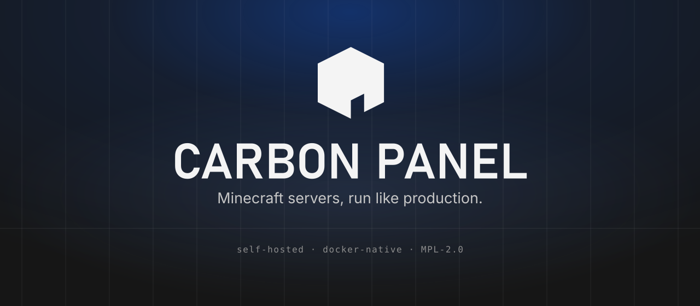

<!--
SPDX-License-Identifier: MIT AND MPL-2.0
This file includes DiscoPanel material under the MIT License,
Copyright (c) 2025 Nicholas W. Heyer. The MIT license text is in LICENSE
and still applies to that inherited material.
Maintainer changes are licensed under the Mozilla Public License, v. 2.0.
If a copy of the MPL was not distributed with this file, You can obtain
one at https://mozilla.org/MPL/2.0/.
-->

<div align="center">
  

  <p><strong>Self-hosted Minecraft server management, built around the way you play.</strong></p>
  <p>Create and share modpacks, find and add datapacks, prepare updates, and let idle servers rest.<br />
  Run your worlds in Docker containers on infrastructure you control.</p>

  <p>
    <a href="https://github.com/athNdev/carbonpanel/actions/workflows/ci.yml"></a>
    <a href="LICENSE.MPL-2.0"></a>
    <a href="https://go.dev/"></a>
    <a href="https://www.docker.com/"></a>
  </p>

  <p>
    <a href="https://athn.dev/carbonpanel/">Website</a> &bull;
    <a href="https://athn.dev/carbonpanel/docs/">Documentation</a> &bull;
    <a href="#quick-start">Quick start</a> &bull;
    <a href="#features">Features</a> &bull;
    <a href="https://github.com/athNdev/carbonpanel/issues">Issues</a>
  </p>
</div>

## Make the world yours

### Modpack Studio: create, export and share

Create a modpack in one place: choose your Minecraft version and loader, search
CurseForge and Modrinth for mods, and work with their dependencies. Export your
pack in formats such as `.mrpack` and packwiz to share with friends or a community,
or deploy it to a server.

### Find datapacks and add them to your server

Search and browse datapacks in the panel, then install them on your server. You
can also upload your own ZIP and manage the packs in a world's datapacks directory.
Pack-format warnings help identify compatibility issues.

### Staged updates

Prepare compatible configuration and content changes in one update batch. Choose
the next restart, a scheduled time, or an idle window to apply them.

Staging leaves the live server untouched. Applying a batch to a running server
includes a restart. Review or discard staged changes before publishing them.

### Sleep, freeze and wake on join

Choose how an empty server rests:

| Mode | What it does |
| --- | --- |
| Native pause | Stops ticking on supported Minecraft versions while retaining memory. |
| Freeze | Suspends the process in memory on supported hosts. |
| Deep sleep | Stops the JVM to release its memory; a player connection triggers a wake. |

The panel and proxy continue using their own resources. Cold starts take time,
and a player may need to retry while a server becomes ready. Support and setup
depend on the server version, host and idle-mode configuration.

## Features

| Area | Included capabilities |
| --- | --- |
| Server management | Vanilla, Paper, Purpur, Fabric, Quilt, Forge, NeoForge, Bedrock and more; per-server containers and resource limits. |
| Player routing | Hostname-aware proxy routing, Velocity forwarding, PROXY protocol and Bedrock UDP support. |
| Modpacks and content | Create and share modpacks in multiple formats; search for and add datapacks. |
| Updates and scheduling | Staged configuration/content batches, scheduled or idle apply windows, task chains and webhooks. |
| Everyday operations | Live console and RCON, file browsing/editing, archive handling and resumable transfers. |
| Backups | World-aware server backups, retention and S3-compatible offsite storage. |
| Your machines | Place servers on compatible local or remote Docker nodes and manage them through one panel. |
| Access | Local accounts, roles and server-scoped permissions, OIDC, API tokens and an audit log. |
| Integrations | Protocol Buffers, Connect RPC/gRPC, an API reference and Prometheus metrics. |

Carbon Panel is under active development. The website documentation displays its
exact application commit, labelled as a development snapshot. Check
[the documentation version](https://athn.dev/carbonpanel/docs/versions/) against
your installation when following a guide.

## Quick start

For the full walkthrough, see
[Docker Compose setup](https://athn.dev/carbonpanel/docs/getting-started/docker-compose/).

### 1. Download the repository and build the image

Requires Docker with Linux containers and Docker Compose.

```bash
git clone https://github.com/athNdev/carbonpanel.git
cd carbonpanel
docker build -f docker/Dockerfile.carbon-panel -t carbon-panel:latest .
```

### 2. Choose your persistent storage paths

Review [docker-compose.yml](docker-compose.yml) before starting. Set the host
paths for data and backups to locations you want to keep. The
`CARBONPANEL_HOST_DATA_PATH` value must match the host side of the data volume.

The included Compose file uses host networking. Review the networking notes in
that file if your deployment needs bridge networking instead.

### 3. Start the panel

```bash
docker compose up -d
```

Open <http://localhost:8080> and create the first administrator account.
Create a server, wait for it to become ready, and configure the address players
will use to connect. Keep world data and the panel database when updating or
recreating containers.

## Documentation and help

| You want to... | Start here |
| --- | --- |
| Understand the panel | [Introduction](https://athn.dev/carbonpanel/docs/introduction/) |
| Install it | [Docker Compose](https://athn.dev/carbonpanel/docs/getting-started/docker-compose/) |
| Configure it | [Configuration](https://athn.dev/carbonpanel/docs/configuration/) and [config.example.yaml](config.example.yaml) |
| Back up a server | [Server backups](https://athn.dev/carbonpanel/docs/guides/backups/) |
| Configure sign-in | [OIDC guides](https://athn.dev/carbonpanel/docs/guides/oidc/keycloak/) |
| Use the API | [API reference](https://athn.dev/carbonpanel/docs/api/); authenticated requests are required for protected operations |
| Resolve a problem | [Troubleshooting](https://athn.dev/carbonpanel/docs/troubleshooting/) and [FAQ](https://athn.dev/carbonpanel/docs/faq/) |
| Check what the docs describe | [Documentation version](https://athn.dev/carbonpanel/docs/versions/) |

Operator references in this repository include
[server operations](docs/runbook-server-operations.md),
[idle-mode setup](docs/runbook-sleep-baseline.md), and
[panel database recovery](docs/runbook-panel-db-restore.md).

For help or a bug report, include the application commit/version, relevant
configuration and redacted logs in an
[issue](https://github.com/athNdev/carbonpanel/issues). Keep tokens, private
addresses and world data out of public reports.

## Development

The backend is Go; the console is SvelteKit with Bun. See
[CONTRIBUTING.md](CONTRIBUTING.md) for contribution and verification guidance.
Current CI uses Go 1.26 and Bun 1.4.2.

Build the frontend before compiling a binary that embeds it:

```bash
bash scripts/web-build.sh
go build -o carbon-panel ./cmd/carbon-panel
./carbon-panel
```

For live development:

```bash
bun run dev
# Or use make dev, scripts/dev.ps1, or scripts/dev.sh.
```

The development frontend runs at <http://localhost:5174> and proxies API/RPC
requests to the backend at <http://localhost:8080>.

## Acknowledgments and credits

Carbon Panel (formerly MineServer) is built upon the open-source foundation of the original
[DiscoPanel](https://github.com/discohaus/discopanel) project created by
[nickheyer](https://github.com/nickheyer).

## License

Carbon Panel's own code is licensed under the **Mozilla Public License 2.0**
([LICENSE.MPL-2.0](LICENSE.MPL-2.0)).

Material inherited from DiscoPanel remains under the **MIT License**
([LICENSE](LICENSE)), Copyright (c) 2025 Nicholas W. Heyer.
[LICENSING.md](LICENSING.md) documents the file-by-file boundary between the two.
