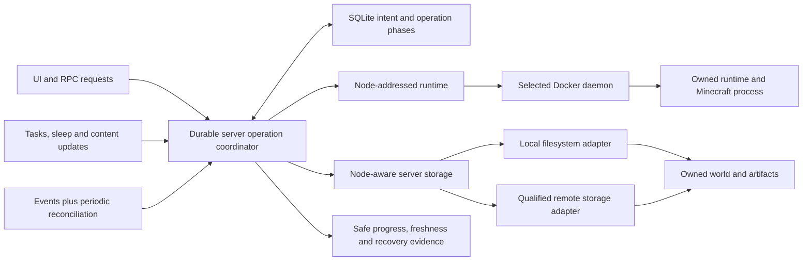

# OSS Docker resilience, data safety and feature completeness

- **Plane Epic:** MINE-249.
- **Status:** source-backed implementation handoff, 2026-10-22. Application fixes, tests and deployments were not performed by this audit.
- **Snapshot:** Carbon Panel HEAD `4cd35359616ffc58602349a61868f763e27f1fb2` plus inspected working tree. `internal/rpc/services/server.go` already has an uncommitted port-probe change; preserve it. Line numbers below are snapshot entry points; refresh source/function context before implementation.
- **Research:** [Docker failure semantics and recovery](../research/docker-failure-semantics-and-recovery.md).
- **Completeness:** [32-feature UI → RPC → runtime/storage matrix](oss-feature-completeness-matrix.md).

## 1. Intended outcome

The OSS panel manages real Minecraft servers reliably when Docker disconnects, restarts, reports uncertain outcomes, recreates containers, changes networking, runs out of resources or encounters incompatible images/mounts. Its advertised features must work through the full selected-node data path, preserve worlds/metadata, report truthful outcomes and recover safely after interruption.

This Epic contains 21 new work packages (MINE-250–270), reuses MINE-224 for integration/fault coverage, and relates existing UI work MINE-225/226/229. It complements the completed MINE-102 orchestrator and MINE-179 hardening Epics; it does not reopen those or pretend their implemented protections are missing. MINE-192 disk quotas and MINE-194 encrypted backups require scoped follow-up because helper existence did not establish runtime wiring in this snapshot.

Scope is OSS single-controller SQLite, local/remote Docker and qualified deployment modes. This is not a proposal to replace Docker, add Kubernetes, migrate OSS to a SaaS database, or import Cloud internal packages. Any new reusable public seam follows independent release compatibility.

## 2. Method, confidence and limits

Source was traced through container creation/recreation, strict and fallback resolution, startup cleanup, reconciler/events, migration/delete, node paths, backups/snapshots, encryption/quota references, scheduler/sleep/module paths, readiness/metrics, frontend entry points, existing tests, ADRs, previous plans and Plane items.

- **Observed source behavior:** the branch/caller ordering exists in inspected code; no live failure is asserted.
- **Missing integration:** a helper/catalog/control exists but no complete caller path was found within the recorded search scope.
- **Qualification gap:** a feature has concrete source but its effective runtime/failure behavior still needs proof.
- **Existing protection:** preserve it; its presence and tests are not a claim that every deployment was verified.

No application tests, Docker mutation, real game connection, visual test, deployment or security scan was run in this planning pass. Before a later agent calls a candidate a confirmed defect, it must reproduce through the actual caller seam and add a regression capable of catching the user's failure. Do not severity-inflate a static observation into a demonstrated incident.

## 3. Existing protections to retain

| Existing mechanism | Source | Preserve while improving |
| --- | --- | --- |
| Minimal itzg bootstrap capabilities, readonly root and NSS skip | `docker/client.go:applyContainerHardening/applyServerRootfs`, `hardening.go` | Fix compatibility through effective config/preflight, not blanket privilege escalation |
| Strict node resolver; fallback disabled by default | `docker/pool.go` | Eliminate downstream caller fallbacks without losing supported explicit local aliases |
| Bounded eager API negotiation and client construction outside shared lock | `docker/client.go:NewAPIClient`, `pool.go` | One dead node must not serialize healthy-node requests |
| Deterministic names/labels, adopt/conflict handling and partial IDs | `docker/client.go`, `recreate_test.go` | Strengthen owner/config identity and uncertain-outcome recovery |
| Reconnect/backoff, periodic authoritative sweep and per-server transition guard | `reconciler/events.go`, `reconciler.go`, `docker/transition.go` | Add dynamic membership/durable intent; do not substitute an event-only model |
| Graceful game/Docker stop ladder and actual OOMKilled classification | `docker/stop.go`, `reconciler.go` | Preserve correct exit-137 versus OOM distinction |
| Bounded on-failure policy and deep-sleep restart coordination | `docker/client.go`, `sleep.go` | Respect clean stop, sleep and wake intent after crashes/restarts |
| JVM/native memory headroom, swap policy, PID and rotated Docker logs | `pkg/utils/memory.go`, `docker/client.go` | Validate effective allocation/enforcement after overrides |
| Transactional node-scoped game/RCON port leases | `db/portlease.go` | Extend protocol/topology coverage instead of refiling absent atomic allocation |
| Archive SHA/CRC checks, per-backup authorization, locks and secure staging | `scheduler/backup.go`, `rpc/services/backup.go` | Add consistency, remote data routing and recoverable cutover |
| Task dedupe/interruption marking and staged config rollback | `scheduler/` | Prove cross-operation crash semantics rather than assume no protection exists |
| File containment, URL/archive bounds and scoped roles/subusers | `rpc/services/file.go`, `pkg/files`, `rbac` | Carry policies into remote adapters and long-lived jobs/streams |

## 4. Highest-impact source findings

1. **Wrong-node fallback remains below a strict pool:** scheduler and command executor can return the default after remote resolution fails (N01).
2. **Startup purge is scoped to managed labels plus DB membership:** foreign/legacy resources or a restored older DB can look orphaned (N02).
3. **Recreate can force-remove after unknown inspect, and preflights image availability after old removal:** retained partial-ID fixes do not remove this ordering risk (N04).
4. **Remote runtime and filesystem disagree:** Docker binds daemon-host paths while files/config/mods/backup/snapshot/disk collection use controller paths (N06/N09).
5. **Migration is not a demonstrated world transfer:** target create/node change occurs without explicit data copy, and stop/DB/route errors can be ignored before source cleanup (N08).
6. **Backup validity and world consistency differ:** save failure can continue, restore directly merges files, and its own mutex does not cover all other world writers (N09).
7. **Completed-feature claims need wiring proof:** encryption is helper-only in scoped references; storage-opt quota helper is uncalled and not a bind-world quota (N10/N13).
8. **Accepted durability and shipped mode disagree:** ADR 0003 describes continuous backup; actual config says daily VACUUM INTO snapshots (N11).
9. **Server-only/static event coverage is incomplete:** watchers fix their node set and modules are excluded from continuous reconcile (N05/N17).
10. **Green API/Docker process is not a playable game:** /readyz is DB-only and observations need source/freshness (N15).

Shared-filesystem deployments can make some local-path operations valid, but only with an explicit verified mapping. Matching strings, a container name, a cached status or a Done ticket is not proof.

## 5. Proposed implementation shape

Keep behavior behind cohesive existing module seams:

- **Node-addressed runtime:** explicit node/daemon generation, typed resolve/observe/execute errors and no hidden fallback.
- **Server storage:** logical server/root and authorized operations, with real local and remote adapters sharing containment/streaming/conflict rules.
- **Operation coordinator:** durable desired intent and phase journal in SQLite; fast process locks remain, and one controller owns execution.
- **Capability evidence:** requested/supported/effective image, mounts, enforcement, network and readiness; unavailable/unknown is not unlimited/healthy.
- **Backup artifact:** independent consistency, integrity, encryption, catalog, local/offsite and restore-verification states.

Do not introduce a parallel orchestrator next to the reconciler. Deepen the shared runtime/storage/operation interfaces and migrate callers deliberately. Proposed interface design must hide retry/ownership/data-policy complexity rather than spread it through handlers.

## 6. Invariants for every fix

- A specified remote node never means the local default when unavailable.
- Owned server identity, container identity, daemon identity and data root are different, versioned facts.
- Unknown state is not confirmed absence; no destructive effect based on a failed observation.
- At most one active writer owns a world during restore/recreate/migration/update/delete.
- Persist recoverable intent before external mutations; observe uncertain outcomes before retry.
- Starting the panel or restoring an older DB does not purge unproven or foreign resources.
- Missing mount/source files never silently become an empty replacement world.
- Backup ZIP integrity, world consistency, encryption, offsite durability and restorability are separate outcomes.
- Resource limits and network/security claims describe effective capabilities, not requested fields.
- Running Docker/green API is not proof of Minecraft readiness.
- Explicit destructive commands affect only authorized owned data; build/dev/cleanup never remove worlds/DBs implicitly.
- Rootless/Desktop/remote unsupported behavior must be surfaced, not repaired by automatic elevated privileges.
- Existing stop/sleep intent, permissions, export and recovery remain usable after failure/upgrade.

## 7. Work packages

Each item below is an actionable handoff, not a record that implementation or reproduction has occurred.

### N01 — MINE-250: Bind every operation to an explicit node and daemon identity

**Priority:** P1 / high. **Evidence:** Source-observed inconsistent resolution; runtime reproduction pending.

**Source:** `internal/docker/pool.go:GetClient/GetClientStrict:184/267`; `internal/scheduler/scheduler.go:dockerForNode:146`; `internal/command/sender.go:resolveExecutor:51`; `internal/rpc/services/server.go:getDockerClient/getDockerClientStrict:83/95`; `internal/rpc/services/backup.go:dockerFor:134`.

**Current protection/behavior:** Strict node resolution exists and the reconciler/metrics use it. Scheduler.dockerForNode and Sender.resolveExecutor can still return the default client/executor after a remote lookup fails; GetClient also has an optional fallback path.

**Trigger:** A remote node is missing, disabled, has invalid credentials, changes endpoint, or cannot be resolved while a background task/command runs.

**Risk:** Commands or lifecycle effects can target an unintended daemon, and a re-pointed endpoint can be mistaken for the previous host.

**Countermeasures:**
- Use an explicit node-addressed runtime interface for every mutating/control/data operation; no fallback for a specified nonlocal node.
- Record/check daemon identity and endpoint generation; invalidate cached clients/watchers/observations when endpoint/TLS/daemon identity changes.
- Keep intentional local aliases explicit; return typed unavailable/identity-mismatch results and preserve intended ownership.

**Implementation sequence:**
1. Inventory all GetClient/default-executor fallbacks including modules, snapshots, tasks, commands, metrics and startup paths.
2. Thread context through node resolution and preserve bounded negotiation/timeouts already present.
3. Add strict unavailable behavior before migrating callers; document local alias and endpoint-rebind migration policy.

**Reproduction/regression handoff:** Future regression: give a server remote node B, make B resolution fail, and instrument local daemon A/command executor. Assert A receives zero requests and the operation returns unavailable; repeat after B endpoint identity changes.

**Acceptance:**
- All specified-node mutations fail closed; unavailable B never falls back to A.
- One unreachable daemon does not block healthy nodes; cache construction stays outside global pool locks.
- Endpoint changes require reconciliation/identity acceptance; observations and operation IDs include node generation.

**Narrow checks:** `go test ./internal/docker ./internal/command ./internal/scheduler ./internal/rpc/services`. These are future verification instructions, not executed results.

**Dependencies:** none; baseline/reproduction may begin.
**Related existing work:** MINE-102, MINE-106, MINE-217.
**Scenario coverage:** D01, D02, D03.

### N02 — MINE-251: Scope container ownership and quarantine orphans before cleanup

**Priority:** P1 / high. **Evidence:** Source-observed destructive ownership gap; no live purge attempted.

**Source:** `internal/docker/cleanup.go:ReconcileAndCleanupContainers:130`; `internal/docker/client.go:CreateContainer labels:868`; `cmd/carbon-panel/main.go:startup cleanup:140`; `internal/docker/cleanup_test.go`.

**Current protection/behavior:** Startup adoption already repairs drifted IDs and aborts purge on DB read failure. Discovery filters carbon-panel.managed=true and then removes labeled identities absent from this database. No installation-owner label is established in that path.

**Trigger:** Two panel installations share a daemon, a fresh/wrong/older restored DB is opened, or a server row was not durably committed before container creation.

**Risk:** A working container can appear orphaned to the current database and be stopped/removed automatically.

**Countermeasures:**
- Persist a controller installation identity and scope all labels/lookups/adoption/events/cleanup to it plus node and logical server/module.
- Default unknown/legacy/foreign ownership to quarantine/report, not delete; require explicit audited purge intent and a recheck.
- Handle DB restore and legacy labels with a deliberate adoption/migration workflow; preserve world mounts and detached resources.

**Implementation sequence:**
1. Add ownership metadata in an additive migration with upgrade/restore semantics.
2. Keep deterministic identity/adoption but reject ambiguous duplicates and foreign name conflicts.
3. Separate inventory, adopt, quarantine and explicit garbage collection; never use absence from a readable DB as sufficient deletion proof.

**Reproduction/regression handoff:** Future fixture: two installations A/B with managed containers on the same daemon, plus a legacy/unlabeled container and a DB restored before a newer server existed. Starting A must not stop/remove B or unknown resources.

**Acceptance:**
- Startup performs no destructive action on foreign, legacy-ambiguous or newly discovered uncommitted resources.
- Explicit purge revalidates owner, operation generation and data-retention disposition immediately before removal.
- Existing safe DB-error abort and drifted-ID adoption remain covered; detach still preserves resources.

**Narrow checks:** `go test ./internal/docker ./internal/reconciler`. These are future verification instructions, not executed results.

**Dependencies:** N01 / MINE-250.
**Related existing work:** MINE-102, MINE-105.
**Scenario coverage:** D04, D05, D06.

### N03 — MINE-252: Persist lifecycle intent and recover interrupted Docker mutations

**Priority:** P1 / high. **Evidence:** Observed process-only serialization; architecture/recovery gap.

**Source:** `internal/docker/transition.go:serverTransitions/TryBeginServerTransition`; `internal/reconciler/reconciler.go:ReconcileServer:449`; `internal/rpc/services/server.go:create/start/stop/recreate/delete handlers`; `internal/scheduler/scheduler.go:FailOrphanedTaskExecutions startup`.

**Current protection/behavior:** The process mutex coordinates several lifecycle callers, the reconciler repairs identity drift and tasks mark interrupted executions failed. There is no demonstrated shared durable phase journal for every server mutation across process crashes; one status field is passed as desired state into reconciliation.

**Trigger:** Panel exits after Docker accepts a request but before SQLite persistence, a client retries after a timeout, or restore/delete/migration overlaps another writer.

**Risk:** Unknown outcomes can be retried as fresh mutations, partial ownership can be lost, or a later reconciler pass can undo an intentional transition.

**Countermeasures:**
- Add a bounded SQLite operation journal with logical operation ID, request digest, server/node generation, desired intent, durable phase, observed resource IDs, retry/compensation state and deadlines.
- Retain in-process locks for fast coordination; explicitly enforce the OSS single-controller policy instead of inventing active/active SQLite.
- Treat timeout/disconnect as unknown until observation; serialize all mutations of one world, including backup restore, staged changes, migration, sleep and delete.

**Implementation sequence:**
1. Document desired versus observed state and typed unavailable/missing/unknown outcomes.
2. Persist intent before external effects, phase checkpoints after observation, and restart recovery before new conflicting work.
3. Define cancellation semantics after external acceptance and safe idempotency-key reuse/conflict; cap retry/backoff and expose recovery-required state.

**Reproduction/regression handoff:** Future crash harness terminates the panel at create/start/stop/remove/DB-commit boundaries, restarts it and retries the same request; verify one logical operation and at most one active world writer.

**Acceptance:**
- Crash recovery can identify the last known and uncertain phase without resetting a live server to a guessed state.
- Repeated identical intent resolves to the same operation; changed payload with same key conflicts.
- All lifecycle paths share one coordinator or explicitly document a safe non-conflicting exemption.

**Narrow checks:** `go test ./internal/docker ./internal/reconciler ./internal/rpc/services ./internal/scheduler`. These are future verification instructions, not executed results.

**Dependencies:** N01 / MINE-250; N02 / MINE-251.
**Related existing work:** MINE-102, MINE-107, MINE-110, MINE-214.
**Scenario coverage:** D07, D08, D09.

### N04 — MINE-253: Make recreation and image changes reversible before removing the old container

**Priority:** P1 / high. **Evidence:** Source-observed unsafe error branch and destructive ordering; reproduction pending.

**Source:** `internal/docker/client.go:RecreateContainer:1420`; `internal/docker/client.go:CreateContainer:711`; `internal/docker/recreate_test.go`; `internal/rpc/services/server_recreate_test.go`; `internal/rpc/services/server.go:recreate/update callers`.

**Current protection/behavior:** Partial replacement IDs and stop failures are already handled. RecreateContainer treats any status-inspect error as if the old container may be absent, then calls force removal. The old container is removed before CreateContainer performs image availability/pull and other checks.

**Trigger:** Inspect returns 503/timeout on a live container, registry access fails, the new image/bootstrap is invalid, or persistence fails during replacement.

**Risk:** A healthy or only recoverable container can be removed without verified stop/preflight, leaving a longer outage and no executable rollback identity.

**Countermeasures:**
- Differentiate confirmed NotFound from unknown inspect failure; block destructive actions on uncertainty.
- Preflight image/digest, resources, mount/UID permissions and effective configuration before removing the known-good container.
- Persist old/new identities and phases, retain the old stopped artifact until safe cutover where possible, and ensure only one process writes the world; do not run blue/green copies on the same writable world.

**Implementation sequence:**
1. Add inspect-failure no-remove regression at the Docker HTTP seam before the fix.
2. Plan a reversible rename/stopped-container retention or equivalent bounded rollback mechanism with port/network conflict handling.
3. Bind configuration/image revision to operation generation and only finalize after game/data readiness; preserve paused/stopped/deep-sleep intent.

**Reproduction/regression handoff:** Future fake Docker server returns 503 for old-container inspect and records DELETE requests; expect zero DELETE. Separate case fails image pull after preflight and proves old executable identity/world remain recoverable.

**Acceptance:**
- Unknown inspect outcomes never trigger Force remove; confirmed NotFound follows explicit recovery.
- Failed replacement/start/DB-save can be resumed or rolled back with visible retained identities.
- Existing graceful-stop, paused-container and partial-create regression tests remain valid.

**Narrow checks:** `go test ./internal/docker ./internal/rpc/services ./internal/reconciler`. These are future verification instructions, not executed results.

**Dependencies:** N03 / MINE-252; N12 / MINE-261; N14 / MINE-263.
**Related existing work:** MINE-145, MINE-171, MINE-172, MINE-211.
**Scenario coverage:** D10, D11, D12.

### N05 — MINE-254: Refresh event watchers and reconcile daemon reconnects dynamically

**Priority:** P2 / medium. **Evidence:** Explicit source limitation and recovery qualification gap.

**Source:** `internal/reconciler/events.go:Supervisor static membership:270/311`; `internal/reconciler/events.go:Watcher.Run/stream:190/233`; `internal/reconciler/reconciler.go:sweepLoop:309`; `internal/docker/pool.go:RemoveNode/client lifecycle`.

**Current protection/behavior:** Event streams reconnect with backoff and a periodic level-triggered sweep exists. Supervisor explicitly fixes its node set at construction/start, so later node additions/removals and cached-client replacement are not dynamically watched.

**Trigger:** A node is added, removed, disabled, has TLS rotated, its daemon restarts, or events are missed during disconnection/backpressure.

**Risk:** Live state/route changes can wait for a sweep or follow an obsolete client; event history cannot safely stand in for authoritative state.

**Countermeasures:**
- Reconcile watcher membership against enabled node/endpoint generations and cancel/replace obsolete watchers.
- Trigger a bounded full node inventory after reconnect and daemon identity change; preserve periodic sweep as the source-of-truth repair path.
- Add jitter, per-node isolation, bounded queues/coalescing and watcher health/last-resync diagnostics; never rely on Docker's bounded event replay as a durable journal.

**Implementation sequence:**
1. Expose node/client membership changes through a narrow interface rather than restarting the panel.
2. Define stream closure, backpressure and shutdown ownership and test no goroutine/subscriber leaks.
3. Measure worst-case recovery latency and avoid one dead node starving the worker queue.

**Reproduction/regression handoff:** Future test adds and removes a node after Start, replaces its endpoint and interrupts the event stream while containers change; expect current state and routes after reconnect/sweep with no panel restart.

**Acceptance:**
- Watcher membership and endpoint generations converge automatically.
- Dropped/reordered events cannot permanently freeze status, routes or logs.
- Disconnected nodes have explicit stale state; healthy nodes remain responsive under a blackholed peer.

**Narrow checks:** `go test ./internal/reconciler ./internal/docker`. These are future verification instructions, not executed results.

**Dependencies:** N01 / MINE-250; N03 / MINE-252.
**Related existing work:** MINE-106, MINE-107, MINE-217.
**Scenario coverage:** D13, D14, D15.

### N06 — MINE-255: Route files, configuration and content I/O through node-aware storage

**Priority:** P1 / high. **Evidence:** Source-observed local/remote integration gap.

**Source:** `internal/rpc/services/file.go:FileService/ListFiles/ReadFile/WriteFile`; `internal/rpc/services/mod.go:server.DataPath filesystem calls`; `internal/rpc/services/config.go`; `internal/metrics/collector.go:collectDiskUsage:447`; `internal/docker/client.go:TranslateToHostPath:184 and bind dataPath:841`.

**Current protection/behavior:** Remote Docker mounts are correctly treated as daemon-host paths in container creation. FileService, mods/config and disk collection still use controller os/files operations on server.DataPath; similarly named controller and daemon paths are not necessarily the same data.

**Trigger:** A server runs on a remote Docker host with a different filesystem, Docker Desktop path translation differs, or the mount points at an unexpected/newly created empty directory.

**Risk:** UI may show/edit the wrong files, calculate wrong usage, or fail operations while the actual game writes elsewhere.

**Countermeasures:**
- Introduce a server/node-addressed storage interface with local-filesystem and qualified remote transport adapters; pass logical server identity and allowed root rather than trusting global paths.
- Cover list/read/write/rename/delete/stat/archive/chunk transfer/config/mod installation and metrics through the same seam.
- Preflight bind identity, writable access, capacity and a safe server sentinel; do not silently create/accept an empty mount as an existing world.

**Implementation sequence:**
1. Inventory all server.DataPath/os.* consumers, including snapshots/backups/migration/modules/support.
2. Specify local-to-daemon path mapping per node and capability statuses; unsupported remote operations fail before mutation with a reason.
3. Preserve containment/symlink/archive limits, binary-safe streaming, authorization and file conflict checks in both adapters.

**Reproduction/regression handoff:** Future two-filesystem fixture gives controller A and daemon B different files at the same path; all server operations must affect B only. Real two-daemon test covers binary hash round-trip and mount identity.

**Acceptance:**
- Local and remote feature behavior is explicit and truthful; no controller filesystem fallback for a specified remote server.
- Remote settings/mod writes, disk usage, upload/download and archive operations refer to the actual world root.
- Path translation and permission failures preserve existing worlds and report actionable diagnostics.

**Narrow checks:** `go test ./internal/rpc/services ./pkg/files ./pkg/upload ./pkg/download ./internal/metrics`. These are future verification instructions, not executed results.

**Dependencies:** N01 / MINE-250; N03 / MINE-252.
**Related existing work:** MINE-36, MINE-149, MINE-160.
**Scenario coverage:** D16, D17, D18.

### N07 — MINE-256: Unify protocol-aware port leases and reachable endpoint contracts

**Priority:** P1 / high. **Evidence:** Existing lease protection with incomplete topology/protocol qualification.

**Source:** `internal/db/portlease.go:ReserveBackendPortPair`; `internal/rpc/services/server.go:isHostPortBound:2628 and create/update paths`; `internal/docker/client.go:validateServerPorts/additionalPortBindings`; `internal/proxy/manager.go`; `internal/proxy/udp.go`.

**Current protection/behavior:** Atomic node-scoped game/RCON port-pair leases and range validation exist. Local OS bind probes are not authoritative for a remote daemon, and primary/additional TCP/UDP/IPv4/IPv6/network-mode paths need a common reservation contract. The user already has an uncommitted port-probe edit in server.go.

**Trigger:** Concurrent create/update/migration, occupied RCON offset, UDP additional service, remote/proxied versus direct networking, or an external process claims a port after preflight.

**Risk:** False conflict detection, double allocation, unreachable player endpoint or accidental management-port exposure.

**Countermeasures:**
- Reserve node/address/protocol/port resources consistently for primary, RCON, extra ports and modules, with lifecycle rollback/reclaim rules.
- Treat local probes as advisory only for the correct namespace; Docker bind outcome and node observations remain authoritative.
- Resolve advertised and dialed endpoints from one topology contract across panel-in-container, same-host, remote, rootless/Desktop and proxy modes.

**Implementation sequence:**
1. Re-read and preserve the current uncommitted server.go change; add contextual tests instead of replacing it wholesale.
2. Handle address-family/network-mode semantics and race-after-check errors without silently changing customer ports.
3. Verify firewall rule intent/effect and report unsupported enforcement rather than claiming protection.

**Reproduction/regression handoff:** Future concurrency fixture races primary/RCON/additional TCP/UDP claims and a remote daemon bind conflict. End-to-end test connects a real player through the advertised route while RCON remains private.

**Acceptance:**
- Lease and effective Docker bindings agree for every advertised protocol/address.
- Failure releases only uncommitted claims and retains live ownership; migration transfers claims safely.
- No remote status is inferred from controller-local socket probes; prior MINE-212 routing fix is preserved.

**Narrow checks:** `go test ./internal/db ./internal/docker ./internal/proxy ./internal/rpc/services`. These are future verification instructions, not executed results.

**Dependencies:** N01 / MINE-250; N03 / MINE-252.
**Related existing work:** MINE-148, MINE-171, MINE-172, MINE-204, MINE-205, MINE-212.
**Scenario coverage:** D19, D20, D21.

### N08 — MINE-257: Transfer and verify worlds before switching node ownership

**Priority:** P1 / high. **Evidence:** Source-observed incomplete migration flow; no live migration attempted.

**Source:** `internal/rpc/services/server.go:MigrateServer:2773`; `internal/docker/client.go:CreateContainer bind root/labels`; `internal/rpc/services/server_migrate_test.go`.

**Current protection/behavior:** MigrateServer selects the target daemon and creates a target container, then changes NodeID. No explicit world-file transfer appears in that flow. Stop/flush and some DB/route failures are ignored; source cleanup can still be scheduled, and the target is created before server.NodeID changes.

**Trigger:** Migration between hosts whose identical path strings refer to different disks, stop fails, target start succeeds but DB commit fails, or another lifecycle operation overlaps.

**Risk:** A fresh/incorrect target world can be called a successful migration; two writers or ownership/label drift can remain, and source recovery may be removed prematurely.

**Countermeasures:**
- Make migration a durable coordinated transfer with source/target identity, ownership, labels, resource/port claims, data manifest/hash and rollback phases.
- Quiesce/stop with verified result; transfer through node-aware storage or explicitly validated shared storage, then verify data and readiness before cutover.
- Commit DB and route ownership before source cleanup; preserve a recoverable source and forbid two active writers.

**Implementation sequence:**
1. Add a two-host fixture where each host starts with different world contents at the same path.
2. Stage/copy/verify the destination and set target labels/config explicitly; treat DB/route/stop errors as recoverable failures, not success logs.
3. Report honest downtime; support offline/paused/sleep intent and no-op same-node cases without claiming seamless live migration.

**Reproduction/regression handoff:** Future migration uses a known world manifest on source and an empty target. Fail stop, transfer, hash, target start, DB update and route cutover separately; each case preserves one authoritative playable world.

**Acceptance:**
- Success requires target world-content equality and player connection, not just ContainerStart.
- DB or route failure prevents irreversible source cleanup and has a resumable operation identity.
- Concurrent recreate/delete/restore cannot interleave with migration; no unscoped background cleanup.

**Narrow checks:** `go test ./internal/rpc/services ./internal/docker ./internal/proxy`. These are future verification instructions, not executed results.

**Dependencies:** N03 / MINE-252; N04 / MINE-253; N06 / MINE-255; N07 / MINE-256; N09 / MINE-258.
**Related existing work:** MINE-36, MINE-145.
**Scenario coverage:** D22, D23, D24.

### N09 — MINE-258: Make backup and restore node-correct, consistent and atomic

**Priority:** P1 / high. **Evidence:** Source-observed consistency, locality and operation-coordination gaps.

**Source:** `internal/scheduler/backup.go:executeBackupTask:60/pauseWorldSaves:234`; `internal/rpc/services/backup.go:RestoreBackup:231`; `internal/snapshot/snapshot.go:archive/restore and pauseWorldSaves`; `internal/rpc/services/backup_authz_test.go`; `internal/scheduler/backup_verify_test.go`.

**Current protection/behavior:** Archive SHA/CRC, per-backup authorization and restore tracking exist. Save-off/flush failure can still continue; restore's separate mutex does not coordinate all lifecycle writers, a failed inspect can bypass stopping, and extraction merges directly into controller server.DataPath.

**Trigger:** RCON save failure, remote server, insufficient staging space, corrupt archive, canceled extract, stale files in the old world, concurrent restore/start/delete, or unknown stop state.

**Risk:** A ZIP can be valid but inconsistent, restore can touch the wrong host or mix old/new files, and an interrupted overwrite can leave the only live world damaged.

**Countermeasures:**
- Use node-aware storage and the shared operation coordinator for backup/snapshot/restore.
- Specify consistency levels: verified quiesced, verified stopped, or explicitly labeled crash-consistent; never silently call a failed flush consistent.
- Verify/decrypt archive before downtime, stage into a clean target, preserve current data, switch atomically or through a journaled platform-safe cutover, then validate and optionally resume prior intent.

**Implementation sequence:**
1. Unify scheduled/manual/pre-update snapshot consistency and recovery rules.
2. Ensure save-on/resume cleanup uses bounded independent context and records failure requiring recovery.
3. Distinguish local verification, offsite upload and restore readiness statuses; prevent pruning the only known recoverable copy.

**Reproduction/regression handoff:** Future fixtures fail save-off, flush, inspect, stop, disk allocation, extraction and restart, with files removed between backup and restore. Assert old world remains recoverable and no stale files survive a successful clean restore.

**Acceptance:**
- Remote backup/restore acts on the correct host and preserves world identity.
- No restore writes while process state is unknown or another operation owns the world.
- A real restored server can be joined and its data verified; CRC-only success is not recovery evidence.

**Narrow checks:** `go test ./internal/scheduler ./internal/snapshot ./internal/rpc/services ./pkg/files`. These are future verification instructions, not executed results.

**Dependencies:** N03 / MINE-252; N06 / MINE-255.
**Related existing work:** MINE-23, MINE-139, MINE-145, MINE-146, MINE-160, MINE-184, MINE-193.
**Scenario coverage:** D25, D26, D27.

### N10 — MINE-259: Complete encrypted offsite artifacts and reconcile retention outcomes

**Priority:** P1 / high. **Evidence:** Source-observed missing runtime wiring plus partial-failure gap.

**Source:** `internal/backupcrypt/encrypt.go and encrypt_test.go`; `internal/scheduler/backup.go:record/upload/prune:148/451`; `internal/rpc/services/backup.go:RestoreBackup/deleteRemoteBackup`; `internal/db/backups.go`; `internal/s3`.

**Current protection/behavior:** backupcrypt provides a tested helper but scoped Go reference search found no production caller. Scheduled backups write plain ZIPs; the restore path verifies ZIP directly. Offsite and metadata failures can be logged while local backup succeeds. Existing commit-before-local-delete behavior is a protection to preserve.

**Trigger:** Encryption is expected from completed MINE-194, offsite upload/DB commit/delete fails, encryption keys are lost/rotated, or retention runs during partial publication.

**Risk:** Users can rely on an unwired feature or infer offsite protection from a local success; orphan objects/metadata or inaccessible backups can accumulate.

**Countermeasures:**
- Implement a versioned authenticated encrypted artifact format and key reference/recovery policy through the real local→offsite→restore pipeline, not only helper tests.
- Stream or otherwise bound memory/staging for large worlds; never log keys; validate authentication before overwriting live data.
- Model local archive, encryption, catalog, offsite upload and retention independently; reconcile orphan uploads and failed deletes without removing the last verified copy.

**Implementation sequence:**
1. Link this as a source-backed follow-up to MINE-194/183/193 rather than claiming their acceptance was proved.
2. Add key ID/format/integrity metadata and an explicit disabled-encryption state; migrate/restore legacy plaintext safely.
3. Expose offsite/encryption freshness and retry state; preserve locked backups and record delete failures.

**Reproduction/regression handoff:** Future end-to-end test creates a backup through the public path, proves the stored/offsite artifact is not plain ZIP, restores with the right key, and rejects wrong/missing keys before data mutation. Inject upload/DB/remote-delete failures.

**Acceptance:**
- Encrypted backup is demonstrated through actual runtime callers and restore, with recoverable key/version handling.
- Local-only success cannot be displayed as offsite-complete; retention respects partial/locked/sole-good copies.
- All failure phases are resumable and account for remaining local/remote artifacts.

**Narrow checks:** `go test ./internal/backupcrypt ./internal/s3 ./internal/scheduler ./internal/rpc/services`. These are future verification instructions, not executed results.

**Dependencies:** N09 / MINE-258.
**Related existing work:** MINE-183, MINE-194, MINE-193.
**Scenario coverage:** D28, D29, D30.

### N11 — MINE-260: Align SQLite durability promises with shipped backup and restore behavior

**Priority:** P1 / high. **Evidence:** Observed architecture/documentation versus implementation mismatch.

**Source:** `docs/adr/0003-sqlite-durability.md`; `internal/config/config.go:DatabaseConfig.PanelBackup:155`; `internal/db/panel_backup.go`; `internal/db/migrations.go`; `internal/db/store.go`.

**Current protection/behavior:** ADR 0003 accepts Litestream-style continuous backup with seconds-scale RPO. Shipped config explicitly describes daily VACUUM INTO snapshots, not Litestream; integrity-checked periodic snapshot/pruning code exists.

**Trigger:** Controller DB loss after the latest daily snapshot, interrupted upgrade, WAL/metadata inconsistency, missing backup destination or restore onto live containers.

**Risk:** Operators may believe a much tighter recovery objective exists; a restored older DB can also make live containers look orphaned.

**Countermeasures:**
- Implement the accepted continuous-backup direction with an explicit supported deployment contract, or obtain an explicit superseding decision; do not silently claim daily snapshots meet seconds RPO.
- Keep OSS single-writer SQLite; prevent accidental duplicate controllers, preserve WAL-safe online backup and additive migration/recovery.
- Define measured last-good backup/replication freshness, offsite configuration, integrity restore drill and post-restore non-destructive resource adoption.

**Implementation sequence:**
1. Audit real config/startup wiring, permissions, shutdown and failure reporting.
2. Specify fresh-install/upgrade/restore behavior for native Linux, containerized and supported Desktop/Windows paths; unsupported combinations must be explicit.
3. Document migration/version backup and rollback with data-retention and ownership-ID recovery; never rollback by deleting new records blindly.

**Reproduction/regression handoff:** Future disposable drill writes known metadata, loses controller DB after a controlled interval, restores the accepted backup mechanism, checks SQLite integrity and safely re-adopts still-running servers.

**Acceptance:**
- Observed RPO and restore evidence match the published supported mode; no false continuous-backup claim.
- Failure to replicate/snapshot is visible with age and actionable error; pruning waits for a verified replacement.
- No dual-writer SQLite or unrequested database migration is introduced.

**Narrow checks:** `go test ./internal/db ./internal/config`. These are future verification instructions, not executed results.

**Dependencies:** none; baseline/reproduction may begin.
**Related existing work:** MINE-55, MINE-181, MINE-207.
**Scenario coverage:** D31, D32, D33.

### N12 — MINE-261: Qualify bootstrap, mounts and least-privilege image overrides

**Priority:** P1 / high. **Evidence:** Qualification gap around existing bootstrap fix.

**Source:** `internal/docker/client.go:applyContainerHardening:130/applyServerRootfs:621`; `internal/docker/hardening.go`; `internal/rpc/services/server_docker_confinement_test.go`; `internal/rpc/services/server_docker_privilege_test.go`; `internal/docker/hardening_test.go`.

**Current protection/behavior:** Default CHOWN/SETGID/SETUID, no-new-privileges, readonly root, writable /data and SKIP_NSSWITCH_CONF are already present. They do not establish arbitrary UID/GID, read-only bind, rootless, tmpfs and custom-image compatibility.

**Trigger:** Operator changes user/UID/GID, image tag/architecture, rootfs/tmpfs/entrypoint or bind ownership, or Docker runs rootless/userns/Desktop.

**Risk:** Minecraft bootstrap loops on permission/read-only errors; a broad privilege workaround can weaken confinement without fixing the actual incompatible contract.

**Countermeasures:**
- Define an explicit image/runtime/bootstrap compatibility profile with required capabilities, writable paths, user behavior, supported mounts and architecture.
- Preflight effective Docker configuration after overrides, permissions and capability availability; return actionable incompatible-setting diagnostics.
- Keep the default bootstrap fix and permission/audit model. Never auto-enable privileged mode, disable no-new-privileges or make root writable to recover.

**Implementation sequence:**
1. Pin/record qualified image identities and upstream entrypoint expectations; validate fresh and existing /data ownership without recursive chown on every restart.
2. Cover root-start-drop-user and supported non-root paths separately, including optional group/user modification behavior.
3. Document repair steps that preserve files/ownership intentionally and qualify tmpfs size/noexec requirements.

**Reproduction/regression handoff:** Future isolated-daemon matrix runs fresh/existing /data with supported UID/GID, rootless/userns, readonly root and overrides; the exact earlier chown/nsswitch/gosu failure must be caught without broadening privilege.

**Acceptance:**
- Every supported profile starts and reaches game readiness with the minimal effective privileges.
- Unsupported combinations fail before disruption with a specific permission/compatibility reason.
- Regression tests inspect effective config including operator overrides, not only helper defaults.

**Narrow checks:** `go test ./internal/docker ./internal/rpc/services`. These are future verification instructions, not executed results.

**Dependencies:** N01 / MINE-250; N06 / MINE-255.
**Related existing work:** MINE-10, MINE-76, MINE-180, MINE-211.
**Scenario coverage:** D34, D35, D36.

### N13 — MINE-262: Verify effective memory, world-disk and runtime limit enforcement

**Priority:** P1 / high. **Evidence:** Existing memory protections with incomplete disk/enforcement wiring.

**Source:** `internal/docker/client.go:ApplyDiskQuota:472/CreateContainer Resources`; `pkg/utils/memory.go`; `internal/metrics/collector.go:collectDiskUsage:447`; `internal/docker/placement.go`; `internal/db/models.go`.

**Current protection/behavior:** JVM headroom, MemorySwap policy, PIDs limit and json-file rotation exist. ApplyDiskQuota only sets storage-opt size and has no production caller in the scoped search; container writable-layer sizing does not bound bind-mounted world data. Rootless limits require runtime capability qualification.

**Trigger:** Runaway world/map/log growth, too-small host disk, concurrent capacity admission, custom JVM memory/CPU overrides, cgroup limits ignored or unsupported storage driver.

**Risk:** An advertised/configured limit may not be enforced, one server can fill a node, or admission can under-account memory/sidecar/backup overhead.

**Countermeasures:**
- Record requested, supported and effective CPU/memory/PID/swap/storage enforcement and expose unknown/unsupported distinctly.
- Treat world-data filesystem quota, container writable layer, tmpfs, logs, image cache, backup staging and free inodes as separate resource budgets.
- Use a qualified node-filesystem/volume quota where supported; otherwise honest warning/admission/alert behavior. Do not claim hard world quota from storage-opt.

**Implementation sequence:**
1. Audit placement/reservation and effective overrides; keep JVM native/off-heap reserve and truthful OOMKilled classification.
2. Specify headroom and thresholds that preserve safe saves/recovery before exhaustion; coordinate imports/updates/backups with staging budget.
3. Qualify Linux rootful/rootless and Desktop capabilities and no-limit fallback policy; never silently accept ignored requested enforcement.

**Reproduction/regression handoff:** Future small disposable filesystem/cgroup tests fill world bind data, container layer, logs and backup staging independently; verify the right signal/limit and preserved neighboring worlds.

**Acceptance:**
- Paid/configured resource UI states correspond to measured enforcement or clearly stated advisory status.
- Limits cannot be bypassed by ordinary settings/sidecars; unsupported backends fail or warn explicitly.
- OOM versus forced-stop errors remain distinct; filling one budget does not imply a different budget is bounded.

**Narrow checks:** `go test ./internal/docker ./internal/metrics ./pkg/utils ./internal/rpc/services`. These are future verification instructions, not executed results.

**Dependencies:** N01 / MINE-250; N06 / MINE-255; N12 / MINE-261.
**Related existing work:** MINE-128, MINE-192, MINE-167.
**Scenario coverage:** D37, D38, D39.

### N14 — MINE-263: Decode image-pull failures and preserve reproducible image identity

**Priority:** P1 / high. **Evidence:** Source-observed stream/error and identity integration gap.

**Source:** `internal/docker/client.go:pullImage:1672/CreateContainer:711`; `internal/docker/client.go:getDockerImage/GetOptimalDockerTag`; `internal/blueprint/blueprint.go`; `internal/docker/module.go`.

**Current protection/behavior:** Warm starts intentionally skip registry checks when the image is cached. pullImage discards streamed JSON bytes with io.Copy and does not interpret embedded error frames. Server image construction is tag-oriented and prefixes itzg/minecraft-server; built-in blueprints can contain full image references.

**Trigger:** Registry stream returns HTTP 200 with an error frame, pull times out after partial download, mutable tags change, platform differs, or a blueprint supplies a full image reference.

**Risk:** A failed pull can be treated as completed or an image choice can be misinterpreted; rollback cannot reliably identify the last working image.

**Countermeasures:**
- Decode Docker JSON pull progress/error messages, preserve cancellation and verify final image presence/identity before create.
- Model requested reference, resolved digest/platform and applied image ID; define explicit pull policy and staged update/rollback.
- Validate tag versus full-reference grammar consistently across servers, blueprints and modules, without silently broadening the allowed-image/security policy.

**Implementation sequence:**
1. Add the embedded-error HTTP fixture before the fix; cap retained progress and expose useful rate-limit/auth/network failures.
2. Preserve offline/warm-cache starts and prevent concurrent pull storms per daemon/reference.
3. Qualify runtime/image compatibility through N12; retain known-good digest/config across failed updates.

**Reproduction/regression handoff:** Future fake Docker endpoint emits {errorDetail:{message:denied},error:denied} in a successful HTTP stream; pull must fail. Test cached offline start, missing architecture and full-reference blueprint separately.

**Acceptance:**
- A success response requires a usable image identity, not EOF alone.
- Mutable-tag updates are intentional/auditable, and failed pulls leave the old runnable image/world available.
- Accepted references round-trip consistently and do not become a duplicated repository prefix.

**Narrow checks:** `go test ./internal/docker ./internal/blueprint ./internal/rpc/services`. These are future verification instructions, not executed results.

**Dependencies:** N01 / MINE-250.
**Related existing work:** MINE-125, MINE-134, MINE-145.
**Scenario coverage:** D40, D41, D42.

### N15 — MINE-264: Separate API readiness, node availability and playable-server health

**Priority:** P1 / high. **Evidence:** Source-observed narrow readiness plus game-health qualification gap.

**Source:** `internal/rpc/server.go:dbReady:630 and /readyz registration`; `internal/docker/client.go:mapContainerState:1499`; `internal/metrics/collector.go`; `internal/proxy/manager.go`; `internal/rpc/services/server.go:list/get status refresh`.

**Current protection/behavior:** /healthz is process health and /readyz checks the database. Docker status/health and SLP/RCON metrics exist, but API ready, runtime available, game starting and externally playable need distinct contracts and freshness.

**Trigger:** DB works while Docker is unavailable, container runs but Minecraft initialization fails, proxy points at an unreachable backend, or observations age during a node outage.

**Risk:** Users or deployments can treat a green endpoint/running container as proof they can create/manage/join a server.

**Countermeasures:**
- Keep lightweight process/database health semantics documented; add capability/runtime readiness and per-node degradation without making all UI inaccessible when one node fails.
- Model desired operation, Docker process, game readiness, route/connectivity and observation freshness separately.
- Use bounded runtime/SLP/RCON/player-path evidence, typed unknown/unavailable/starting states and startup deadlines; never synthesize healthy metrics.

**Implementation sequence:**
1. Define safe read/manage behavior while dependencies are impaired and clear status ownership across reconciler/metrics/RPC/UI.
2. Expose per-node probes and last successful observations with retry/recovery guidance.
3. Qualify real player connection and restored-world readiness in release evidence; do not reboot/restart all servers on a failed health probe.

**Reproduction/regression handoff:** Future fixture keeps SQLite/API alive while Docker is blackholed, then runs a container with a non-joinable game and stale SLP. API capability and per-server health must state the real limitation.

**Acceptance:**
- Health endpoints and UI state cannot overclaim functioning Docker or playable Minecraft.
- Healthy nodes and read-only diagnostics work while one node is down.
- Readiness evidence has source, timestamp and timeout/recovery outcome; unknown never becomes stopped/missing by inference.

**Narrow checks:** `go test ./internal/rpc ./internal/rpc/handlers ./internal/docker ./internal/metrics ./internal/reconciler`. These are future verification instructions, not executed results.

**Dependencies:** N01 / MINE-250; N03 / MINE-252; N05 / MINE-254; N12 / MINE-261.
**Related existing work:** MINE-151, MINE-211, MINE-217.
**Scenario coverage:** D43, D44, D45.

### N16 — MINE-265: Coordinate tasks, content updates and sleep with durable server operations

**Priority:** P2 / medium. **Evidence:** Existing automation protections with cross-path qualification gaps.

**Source:** `internal/scheduler/scheduler.go:tryClaimTask:346/Start:161`; `internal/scheduler/staged_config.go`; `internal/scheduler/backup.go`; `internal/docker/sleep.go`; `internal/docker/freezer.go`; `internal/packwiz`.

**Current protection/behavior:** Task in-memory dedupe, running-execution checks, startup interruption recovery, staged config and sleep transition locks exist. These do not prove transactional exactly-once effects or safe ordering across every task/content/restore/delete path.

**Trigger:** Manual/event/cron triggers collide, clock/DST changes, panel dies mid-update, wake arrives during restore, save-on recovery fails, or pack update partially writes files.

**Risk:** Repeated/overlapping effects, hidden interrupted jobs, reverted desired state, or a server waking against partially restored/updated data.

**Countermeasures:**
- Dispatch task actions through the durable operation coordinator with explicit conflict and missed-run policy.
- Persist action inputs/revision/phase; use staged content/config writes, backup/checkpoint and rollback before starting a changed server.
- Preserve on-failure/deep-sleep coordination, coalesce wake requests and ensure cancellation does not undo completed external effects or strand save-off.

**Implementation sequence:**
1. Review database-error handling in task running checks; reject/queue when ownership cannot be established.
2. Define cron timezone/DST, catch-up/skip, chains, event dedupe and retry policies.
3. Make job progress/history resumable across reconnect/restart with explicit failed/recovery-required reasons.

**Reproduction/regression handoff:** Future fault/concurrency tests combine cron+manual task, backup+sleep, restore+wake, update+recreate and process restart mid-commit; one authoritative world/operation survives.

**Acceptance:**
- No conflicting automation can run concurrently on the same world, including restore/migration/delete.
- Intentional clean stops/sleep are not turned into restart loops; wake cannot bypass suspension/deletion intent.
- A retried chain does not blindly repeat non-idempotent commands; interrupted jobs expose safe next action.

**Narrow checks:** `go test ./internal/scheduler ./internal/docker ./internal/packwiz`. These are future verification instructions, not executed results.

**Dependencies:** N03 / MINE-252; N04 / MINE-253; N09 / MINE-258; N15 / MINE-264.
**Related existing work:** MINE-19, MINE-21, MINE-145, MINE-193, MINE-214.
**Scenario coverage:** D46, D47, D48.

### N17 — MINE-266: Reconcile module containers and complete sidecar lifecycle recovery

**Priority:** P2 / medium. **Evidence:** Explicit server-only reconciler limitation; module qualification gap.

**Source:** `internal/reconciler/reconciler.go:consume module exclusion:298`; `internal/docker/module.go`; `internal/module/manager.go`; `internal/module/hooks.go`; `internal/rpc/services/module.go`; `internal/module/delete_reliability_test.go`.

**Current protection/behavior:** Module templates, hooks, lifecycle and safe delete tests are present. The event consumer explicitly reconciles server IDs only; module containers do not receive the same continuous convergence path.

**Trigger:** Module container is recreated/deleted externally, daemon restarts, dependency readiness changes, a hook retries, or parent server migrates/deletes.

**Risk:** Sidecar status/ports/data/relationships can drift while the main game appears healthy; repeated hooks can create duplicate resources or stale dependencies.

**Countermeasures:**
- Extend logical identity/ownership, desired-versus-observed state and durable operation coordination to modules without sharing unsafe server assumptions.
- Define parent/dependency readiness, port/resource reservations, mounted data ownership and safe hook retry/rollback.
- Qualify built-in Geyser/proxy/map/database or other templates according to actual supported capabilities; do not describe all modules as missing.

**Implementation sequence:**
1. Inventory module event, startup adoption, orphan handling, log/metrics and route recovery paths.
2. Add drift reconciliation for modules and dependency propagation after server recreate/migration.
3. Treat arbitrary host extension/templates as privileged operator features, retaining confinement and resource accounting.

**Reproduction/regression handoff:** Future module fixture externally replaces a running module, loses its container during daemon restart, fails a hook and races parent delete; identity/state/ports converge without duplicate sidecar or data loss.

**Acceptance:**
- Module UI state and actual container identity converge after drift and reconnect.
- Parent deletion/migration has an explicit recoverable child policy; sidecar data is not casually purged.
- Existing module deletion/provenance/permission tests remain and gain real user-path evidence.

**Narrow checks:** `go test ./internal/module ./internal/docker ./internal/reconciler ./internal/rpc/services`. These are future verification instructions, not executed results.

**Dependencies:** N02 / MINE-251; N03 / MINE-252; N06 / MINE-255; N07 / MINE-256.
**Related existing work:** MINE-168, MINE-179.
**Scenario coverage:** D49, D50, D51.

### N18 — MINE-267: Make deletion, detachment and world disposition resumable and node-safe

**Priority:** P1 / high. **Evidence:** Source-observed non-atomic delete/data-disposition gap.

**Source:** `internal/rpc/services/server.go:DeleteServer:1638`; `internal/rpc/services/server.go:os.RemoveAll(server.DataPath):1706`; `internal/db/store.go:DeleteServer and cascades`; `internal/rpc/services/file.go:import/export handlers`; `internal/docker/cleanup.go`.

**Current protection/behavior:** Delete stops/removes Docker resources before DB deletion and keeps routes until earlier cleanup succeeds. It then deletes the DB record and calls controller os.RemoveAll(server.DataPath), logging filesystem deletion failure but returning success.

**Trigger:** Remote server deletion, DB delete succeeds but path cleanup fails, canceled request, missing/wrong data-root mapping, partial child/module removal, or operator chooses detach/export instead of delete.

**Risk:** Remote data may be orphaned or an unrelated local path affected; failed cleanup loses metadata needed for a safe retry, and retained resources can be misclassified later.

**Countermeasures:**
- Separate stop/remove, detach, world export/retention and irreversible data deletion with explicit permissions/confirmation.
- Persist a deletion tombstone/operation until all node-specific resources and data disposition are observed; retain metadata for retries/audit.
- Use the node-aware storage root and ownership markers; reject unsafe/empty/mismatched roots and never automatically prune unrelated Docker volumes.

**Implementation sequence:**
1. Define idempotent phase ordering with modules, proxy/direct-knock, port leases, backups and audit.
2. Make deletion failure visible and resumable rather than a log-only success; retain explicit retained-data references.
3. Preserve detach and export paths and ensure restored older DB does not authorize orphan purge.

**Reproduction/regression handoff:** Future test deletes a remote server whose path also exists on controller, fails DB/filesystem/route/child cleanup at each stage, then restarts and retries; only owned data is affected and metadata survives until settled.

**Acceptance:**
- Delete completion means the chosen data/resource disposition is accounted for, not simply DB row gone.
- Detach preserves world/container as promised; filesystem failure produces a recoverable state with safe retry.
- No source-less RemoveAll, volume prune or partial archive import can remove another server's data.

**Narrow checks:** `go test ./internal/rpc/services ./internal/db ./internal/module ./pkg/files`. These are future verification instructions, not executed results.

**Dependencies:** N02 / MINE-251; N03 / MINE-252; N06 / MINE-255; N09 / MINE-258.
**Related existing work:** MINE-105, MINE-139, MINE-183.
**Scenario coverage:** D52, D53, D54.

### N19 — MINE-268: Expose operation evidence, stale observations and actionable recovery

**Priority:** P2 / medium. **Evidence:** Cross-cutting observability and handoff gap; reuse open UI issues.

**Source:** `internal/events`; `internal/activity`; `internal/rpc/services/activity.go`; `internal/rpc/services/support.go`; `pkg/logger/log_streamer.go`; `web/carbon-panel/src/lib/components/server-activity.svelte`; `web/carbon-panel/src/lib/components/server-console.svelte`.

**Current protection/behavior:** Activity, event bus, support bundles, log subscriber migration and per-route improvements exist. New durable operations/node capability states need a consistent safe diagnostic projection; open MINE-225/226/229 already own generic UI recovery/layout.

**Trigger:** A request times out with unknown Docker outcome, reconnect loses progress, a node is stale, backup is only local/offsite failed, or a user repeats a destructive action because nothing appears to happen.

**Risk:** Users can misread success or retry blindly; later agents/operators lack correlated evidence to distinguish daemon, image, mount, game and DB failures.

**Countermeasures:**
- Correlate operation/server/node/daemon-generation/container/image/phase with timestamps, last-good observations and stable reason codes.
- Provide a redacted per-server operation timeline, in-flight/unknown/failed/recovered states, safe retries and support-bundle evidence.
- Carry asynchronous progress across RPC/WS reconnects and container log identity changes; revoke unauthorized streams and bound buffers.

**Implementation sequence:**
1. Specify backend structured events/metrics before wiring the existing UI tickets.
2. Link MINE-225 error/empty/loading, MINE-226 safe retries and MINE-229 stable layout rather than duplicating them.
3. Document actionable recovery paths for permission, port, pull, stale node, partial restore/migration and disk exhaustion.

**Reproduction/regression handoff:** Future end-to-end fixture disconnects browser and daemon at several operation phases, reconnects and opens diagnostics; current outcome and safe action remain understandable without secret or cross-server leakage.

**Acceptance:**
- Every high-risk operation has a correlation ID, durable phase and safe next action; uncertain outcome is visibly distinct from failure/success.
- Diagnostics redact credentials/player/private data and do not require privileged Docker socket access for ordinary users.
- UI does not blindly retry non-idempotent requests or lose console subscriptions after recreation.

**Narrow checks:** `go test ./internal/rpc/services ./pkg/logger; affected frontend bun run check and bun run test`. These are future verification instructions, not executed results.

**Dependencies:** N03 / MINE-252; N05 / MINE-254; N15 / MINE-264.
**Related existing work:** MINE-225, MINE-226, MINE-229, MINE-129, MINE-151.
**Scenario coverage:** D55, D56, D57.

### N20 — MINE-269: Qualify deployment modes, upgrades and data-preserving rollback

**Priority:** P1 / high. **Evidence:** Portability and release evidence gap; no deployment changes in this audit.

**Source:** `.github/workflows/ci.yml`; `scripts/web-build.sh`; `docker/Dockerfile.carbon-panel`; `docker-compose.yml`; `scripts/docker-cd.sh`; `docs/plans/reliability-hardening.md`; `docs/adr/0003-sqlite-durability.md`.

**Current protection/behavior:** The project has CI, release/deployment files and earlier cleanup/bootstrap fixes. Their presence does not qualify actual supported Linux/rootless/Desktop/remote paths, real upgrades, full recovery or every effective container override.

**Trigger:** A clean install lacks a local path/tool, controller runs in Docker with a different host root, Docker/SDK/image versions change, or a failed upgrade needs rollback while worlds continue running.

**Risk:** A green build can ship an unusable deployment or require a developer's environment; rollback can lose new metadata or overwrite user data.

**Countermeasures:**
- Publish a supported-mode/capability matrix with exact tested Docker/API/platform/storage/network/image combinations; mark unsupported modes honestly.
- Run from clean release artifacts with pinned/reproducible tool and image identity, no sibling checkout, workstation paths, cluster addresses or secret defaults.
- Define reversible controller/schema/config/image upgrades, SQLite backup/integrity and world retention; disable risky management paths before destructive rollback.

**Implementation sequence:**
1. Reuse the fault harness in MINE-224 with isolated daemons and storage; no tests mutate operator workloads.
2. Require a real create→join→edit→backup→restore→restart→export path in each claimed mode, plus interrupted upgrade/disk-full rollback.
3. Retain prior known-good artifacts and verify mounted data/ownership and current schema compatibility before switching.

**Reproduction/regression handoff:** Future clean-machine/release-container fixtures install and upgrade an existing server, inject bad image/DB/config/disk failure, and roll back while proving world/metadata integrity and continued game access.

**Acceptance:**
- Supported deployments are qualified by real user-path evidence, not only HTTP health or fake Docker calls.
- CI applies meaningful regression/race/fault coverage and builds affected frontend/proto/release artifacts per AGENTS.md.
- Clean/dev/build commands preserve user data; destructive cleanup is explicit and individually scoped.

**Narrow checks:** `go test ./...`; `go vet ./...`; `bun install --frozen-lockfile; bun run check; bun run test (web/carbon-panel)`; `bash scripts/web-build.sh; make proto-lint when affected`. These are future verification instructions, not executed results.

**Dependencies:** N04 / MINE-253; N10 / MINE-259; N11 / MINE-260; N13 / MINE-262; N17 / MINE-266; N18 / MINE-267; N19 / MINE-268; N21 / MINE-270.
**Related existing work:** MINE-75, MINE-98, MINE-224.
**Scenario coverage:** D58, D59, D60.

### N21 — MINE-270: Close advertised OSS workflows against a capability and journey matrix

**Priority:** P2 / medium. **Evidence:** Feature completeness qualification with concrete integration gaps.

**Source:** `README.md advertised features`; `web/carbon-panel/src/routes/servers/[id]/+page.svelte`; `web/carbon-panel/src/routes/servers/new/+page.svelte`; `internal/blueprint/blueprint.go`; `internal/rpc/services`; `docs/plans/oss-feature-completeness-matrix.md`.

**Current protection/behavior:** OSS has eleven server tabs, broad runtime/content/Studio workflows, roles/API and automation. Source presence is credited. Remote storage/migration, encryption/quota helper wiring, module convergence and blueprint/image creation need integration work; a built-in Bedrock preset or Geyser module is not proof of a complete native Bedrock server flow.

**Trigger:** A user follows an advertised create/configure/modpack/file/player/backup/migrate/module workflow in a claimed deployment mode and encounters an unsupported step or misleading success.

**Risk:** Feature checklists can be marked complete while essential UI→RPC→runtime→storage behavior is missing or unsafe under failure.

**Countermeasures:**
- Maintain a source-backed feature matrix with UI, RPC, node/storage path, local/remote capability, error recovery, permission and release evidence.
- Close actual missing integrations via the related work packages, disable or explain unsupported actions, and keep complete existing features intact.
- Validate end-to-end journeys across runtime/version selection, modpacks/Studio/exchange, files, players, templates, modules, sleep/proxy, recovery and safe departure.

**Implementation sequence:**
1. Treat capability absence, integration gap, unqualified behavior and already-handled behavior as different states.
2. Verify blueprint picker/use and full-image/tag grammar; expose native Bedrock only after edition/runtime/network/file/control paths are qualified. Geyser remains its own module capability.
3. Split additional fixes only after an agent traces a real user path and produces a specific failure signal; do not create TODO-based generic cleanup tickets.

**Reproduction/regression handoff:** Future acceptance runs one complete source-defined scenario per advertised feature/mode with denied-permission and interrupted-dependency cases, recording actual world/artifact/command results rather than rendered tabs.

**Acceptance:**
- Every advertised feature has qualified behavior or a visible supported-mode limitation and mapped implementation owner.
- No 'Done' decision relies solely on a helper/proto/tab/test name; encrypted/offsite restore, world quota and migration require real path evidence.
- Core workflows are complete for local and each claimed remote mode, with export and recovery preserved.

**Narrow checks:** `Relevant backend and frontend checks per feature; shared real-daemon journeys in MINE-224`. These are future verification instructions, not executed results.

**Dependencies:** N06 / MINE-255; N08 / MINE-257; N09 / MINE-258; N16 / MINE-265; N17 / MINE-266; N18 / MINE-267.
**Related existing work:** MINE-66, MINE-79, MINE-159, MINE-192, MINE-194, MINE-224, MINE-225, MINE-226, MINE-229.
**Scenario coverage:** O01–O32, J01–J07.

### Existing MINE-224 — shared fault and user-path integration coverage

Reuse and enrich the open integration issue, preserving its original scope/history. It becomes a child of MINE-249 rather than a duplicate ticket. Its test harness can begin alongside the first fixes; final Epic acceptance requires all relevant scenarios to pass.

Use protocol-faithful Docker HTTP fixtures for exact error/status/stream behavior; use isolated real-daemon and two-host fixtures for mount, port, image, cgroup, game and data semantics. A helper fake cannot prove remote file locality, real bootstrap or a playable restored world. Add meaningful regression coverage at the closest integration seam before fixes.

CI fixtures have their own installation labels, disposable worlds and explicit cleanup inventory. Never prune shared daemon containers, images, volumes or developer data. Record fixture ownership and cleanup results. Run realistic faults on temporary storage with bounded size; do not deliberately fill operator filesystems.

## 8. Sixty fault scenarios

These are future acceptance cases, not executed results.

| ID | Work package | Injected trigger | Required observable outcome |
| --- | --- | --- | --- |
| D01 | N01 / MINE-250 | Remote B resolution fails | Local daemon A receives zero operations; return typed unavailable |
| D02 | N01 / MINE-250 | Node endpoint points to a different daemon | Old generation is invalidated; explicit identity reconciliation precedes mutations |
| D03 | N01 / MINE-250 | One daemon blackholes requests | Bounded node-specific failure; other nodes and read-only diagnostics remain responsive |
| D04 | N02 / MINE-251 | Two panel installations share one daemon | Starting A neither adopts nor removes B's resources |
| D05 | N02 / MINE-251 | Restored DB predates a still-running server | Unknown owned resources are quarantined, not automatically purged |
| D06 | N02 / MINE-251 | Legacy label or foreign deterministic-name conflict | No guess-based adoption/removal; operator has safe inventory evidence |
| D07 | N03 / MINE-252 | Crash after Docker create before DB records outcome | Restart observes and resumes one logical operation/resource identity |
| D08 | N03 / MINE-252 | Retry the same key with changed request | Return conflict; no second unrelated mutation |
| D09 | N03 / MINE-252 | Restore/start/delete run concurrently | One authoritative world writer and serialized/conflicting operations |
| D10 | N04 / MINE-253 | Old-container inspect times out or returns 503 | No force-remove; retain identity and unknown observation |
| D11 | N04 / MINE-253 | Replacement image/preflight fails | Old executable identity and world remain recoverable |
| D12 | N04 / MINE-253 | New container starts but persistence/finalization fails | Persist/recover partial identities and safe rollback phase |
| D13 | N05 / MINE-254 | Add/remove/disable node after watcher startup | Watcher membership and cancellation converge without restarting panel |
| D14 | N05 / MINE-254 | Daemon restarts and events are lost beyond replay capacity | Full inventory plus sweep reconstructs current state |
| D15 | N05 / MINE-254 | Event flood, closed stream or endpoint replacement | Bounded work and no abandoned watcher/goroutine/subscriber |
| D16 | N06 / MINE-255 | Controller and remote host have different files at same path | All world operations affect the selected remote root only |
| D17 | N06 / MINE-255 | Mount missing, readonly, wrong owner or wrong sentinel | Fail preflight instead of silently booting an empty replacement world |
| D18 | N06 / MINE-255 | Remote binary upload interrupted before final rename | Hashes and original destination remain intact; safe resume/cancel |
| D19 | N07 / MINE-256 | Concurrent primary/RCON/additional TCP/UDP allocation | No conflicting node/address/protocol claims |
| D20 | N07 / MINE-256 | External process claims a port after preflight | Typed bind failure and safe claim cleanup; no silent port substitution |
| D21 | N07 / MINE-256 | Proxy/remote/Desktop/IPv6 topology differs | Advertised endpoint is joinable and management ports stay private |
| D22 | N08 / MINE-257 | Move source world to an empty remote host | Verified manifest/data transfer precedes ownership and route cutover |
| D23 | N08 / MINE-257 | Stop/DB/route/target-start phase fails | Source remains recoverable; no false migration success or premature cleanup |
| D24 | N08 / MINE-257 | Migration races recreate/delete/restore | One writer; target labels/node claims match committed ownership |
| D25 | N09 / MINE-258 | save-off or save-all flush fails | Fail or mark explicit crash-consistent policy; no false consistent backup |
| D26 | N09 / MINE-258 | Inspect/stop unknown or restore overlaps start | No archive writes into an unproven live world |
| D27 | N09 / MINE-258 | Extract/space/cancel/restart failure during restore | Clean staged cutover, original data recoverable and no stale-file merge |
| D28 | N10 / MINE-259 | Create/restore through actual encrypted backup path | Stored/offsite artifact is authenticated ciphertext; correct-key restore works |
| D29 | N10 / MINE-259 | Wrong/missing key or modified ciphertext | Reject before live data mutation and retain recovery references |
| D30 | N10 / MINE-259 | Upload/catalog/delete/prune fails separately | Independent phase state; last verified copy retained and artifacts reconciled |
| D31 | N11 / MINE-260 | Lose controller DB between backup intervals | Observed restore point matches accepted published durability mode |
| D32 | N11 / MINE-260 | Upgrade/replication target/integrity check fails | Keep last good backup and surface freshness/repair requirement |
| D33 | N11 / MINE-260 | Restore old DB while owned games keep running | Non-destructive resource reconciliation; no orphan purge of newer worlds |
| D34 | N12 / MINE-261 | Custom UID/GID/read-only/rootless combination | Supported effective profile boots; unsupported profile gives actionable preflight error |
| D35 | N12 / MINE-261 | Operator override removes required bootstrap behavior | Fail qualification without enabling privileged/writable-root fallback |
| D36 | N12 / MINE-261 | Existing data has unexpected ownership or tmpfs requirements | Preserve contents and diagnose bounded required repair |
| D37 | N13 / MINE-262 | World bind filesystem fills | Correct world quota/advisory and headroom response; layer limit not misrepresented |
| D38 | N13 / MINE-262 | Rootless daemon ignores requested controllers | Effective enforcement unknown/unsupported, not a successful hard-limit claim |
| D39 | N13 / MINE-262 | Heap/CPU overrides, sidecars, logs and staging exhaust budget | Admission/telemetry accounts for actual limits and separate resource pools |
| D40 | N14 / MINE-263 | HTTP 200 image-pull stream contains error frame | Decode and return failure; EOF is not enough |
| D41 | N14 / MINE-263 | Cached image offline or concurrent same-image pulls | Preserve warm/offline behavior and avoid pull storms |
| D42 | N14 / MINE-263 | Mutable tag/platform/full-reference blueprint differs | Record/validate digest, platform and reference grammar; known-good rollback retained |
| D43 | N15 / MINE-264 | DB ready but Docker unavailable | Documented API readiness plus runtime-specific unavailable/degraded signal |
| D44 | N15 / MINE-264 | Container running but game/proxy not joinable | Do not claim playable; show bounded startup/route failure |
| D45 | N15 / MINE-264 | RCON/SLP/stats age during outage | Per-source stale/unknown state rather than healthy defaults |
| D46 | N16 / MINE-265 | Cron/manual/event triggers collide or DST shifts | Explicit run/skip/catch-up policy and no duplicate non-idempotent effects |
| D47 | N16 / MINE-265 | Wake arrives during restore/update/delete | Operation conflict/queue honors latest intent without touching partial data |
| D48 | N16 / MINE-265 | Crash/cancel after staged writes or save-off | Journaled recovery and bounded save-on/resume; no silent partial success |
| D49 | N17 / MINE-266 | Module externally replaced/deleted | Logical module identity, status/logs/routes converge |
| D50 | N17 / MINE-266 | Dependency/hook retry after daemon restart | No duplicate sidecar or leaked ports/resources |
| D51 | N17 / MINE-266 | Parent migrates/deletes with module data | Explicit recoverable child lifecycle and retained owned data policy |
| D52 | N18 / MINE-267 | Remote delete has same-named local controller path | Only node-owned root is affected; controller files untouched |
| D53 | N18 / MINE-267 | DB/resource/file deletion fails after partial completion | Tombstone/phase remains for restart/retry until disposition settles |
| D54 | N18 / MINE-267 | Detach/export selected instead of delete | World/runtime retained as promised; no implicit prune or root guessing |
| D55 | N19 / MINE-268 | Browser disconnects during unknown Docker outcome | Operation identity/progress survives; no blind retry |
| D56 | N19 / MINE-268 | Container recreation changes logs/route identity | Subscriptions recover and correlate to the current server generation |
| D57 | N19 / MINE-268 | Diagnostic bundle includes secrets/private player data | Redacted useful evidence with permissioned access and correlation |
| D58 | N20 / MINE-269 | Fresh artifact install on each claimed mode | No workstation/sibling-checkout dependency; create-to-join path works |
| D59 | N20 / MINE-269 | Interrupted upgrade and disk-full rollback | Old compatible artifacts/DB/worlds recover without deleting new orders/data |
| D60 | N20 / MINE-269 | Clean/dev/build or fixture cleanup runs | Only explicit owned build/test artifacts removed; persistent user data preserved |

## 9. Supported modes and evidence obligations

| Mode | Minimum evidence and limitations |
| --- | --- |
| Native Linux + local rootful Docker | Full create/join/manage/backup/restore/export; bind ownership, cgroup and actual endpoint enforcement |
| Controller container + same-host Docker | Host-root mapping and controller namespace differ; mounted world identity must match daemon source |
| Remote TLS Docker without shared storage | Strict node identity and complete qualified remote file/archive/config/mod/backup transport; no controller-path fallback |
| Explicit shared-filesystem remote mode | Declare/verify the mapping and one-writer/failure semantics; do not infer shared storage from path text |
| Rootless/userns | Socket/UID/mount/network and cgroup delegation capabilities; distinguish supported and ignored limits |
| Docker Desktop/WSL-backed daemon | Guest VM path translation, named pipes/sockets, IPv4/IPv6/port reachability and host interruption; no workstation-specific assumptions |
| Native Windows controller, if claimed | Filesystem/cancellation/rename/permissions/shutdown and supported daemon transport; skip only explicitly unsupported runtime scenarios with a recorded reason |
| Offline/cached operation | Preserve cached image/content starts under a clear pull/update policy; unavailable online features return safe reasons |

Supported does not mean every feature is universally available. Each advertised mode must declare its capability and complete the selected user journeys; otherwise mark the specific operation unavailable before mutation.

## 10. Feature completeness and user journeys

The companion has O01–O32 rows spanning node/runtime/blueprints, server power/state/resources, staged config, console/players, files/transfers/worlds, addons/packs/Studio, update/backup/encryption/restore, schedules/sleep/proxy/ports, metrics/modules/migration, identity/roles/API/support and portable installation.

J01: fresh supported install → select node/runtime → create → externally join → edit settings/content → restart with same world.

J02: repeat on a remote daemon with a different filesystem and binary-safe transfer checks.

J03: backup/export → destroy only disposable runtime → restore clean allocation → join and verify world.

J04: conflicting stop/recreate/backup/update/sleep plus controller/daemon faults → one authoritative outcome and writer.

J05: delegated user acts on one allowed server; revoke during stream/transfer/task → scoped policy enforced.

J06: unavailable node/full disk/registry outage/bad modpack → actionable diagnosis and safe retry/rollback.

J07: upgrade/rollback/reinstall with persistent DB/worlds/backups and intentional stopped server → data and intent preserved.

MINE-270 coordinates completeness; generic UI state/error/retry/layout work remains in MINE-225/226/229. Those cross-app/general tickets are related, not silently reparented or duplicated. Every source-present workflow needs real UI-to-runtime evidence; helper/proto/catalog presence is insufficient.

## 11. Execution order and regression safety

1. Capture baseline versions, untouched user changes, disposable fixture ownership and exact failure signals.
2. Begin MINE-224 harness and identity/quarantine/durable-operation foundations N01/N02/N03 in narrow compatible slices.
3. Add node-aware storage N06, image N14, network N07 and bootstrap N12, then reversible recreation N04 and event recovery N05.
4. Complete consistent backup N09, offsite/encryption N10, explicit DB durability N11 and effective resources N13.
5. Complete verified migration N08, automation N16, modules N17, deletion N18 and readiness N15; follow explicit dependency links rather than guessed broad rewrites.
6. Wire structured diagnostics N19 through the existing UI tickets, close the feature matrix N21 and qualify releases/upgrade recovery N20.
7. Require evidence of original failure turning green, real game connection, restored/exported world and authorization-negative cases before closing the relevant tickets.

The dependency graph is acyclic; testing is a continuing prerequisite/evidence activity, not postponed until after all fixes. Source changes may alter ordering; refresh the graph without discarding the invariants.

Each implementation PR should state concrete trigger, changed behavior, regression evidence, data/compatibility risks and rollback. Preserve existing labels/NodeIDs/ServerIDs through additive migration and retain old records needed by recovery. Never mark old Done items as proof a new scenario works.

## 12. Checks and final acceptance

Follow AGENTS.md: narrow package regressions first; then `go test ./...` and `go vet ./...` for backend changes; frozen frontend dependencies plus `bun run check` and `bun run test` for changed web surfaces; `bash scripts/web-build.sh` and proto lint for affected artifacts. Add meaningful race/cancellation/fault coverage, not implementation-mirroring tests.

The Epic is complete when every P1 integration/unsafe branch has a reproducible regression and fixed actual use path, the declared modes and O01–O32 rows have current evidence/disposition, relevant D01–D60 and J01–J07 pass, cleanup preserves data, and release/rollback is portable and recoverable. Unsupported capabilities must be documented truthfully rather than silently advertised as complete.

This planning pass creates the handoff only. No claim is made that app tests passed, live faults were reproduced, vulnerabilities validated, code fixed, CI green or deployments updated.

